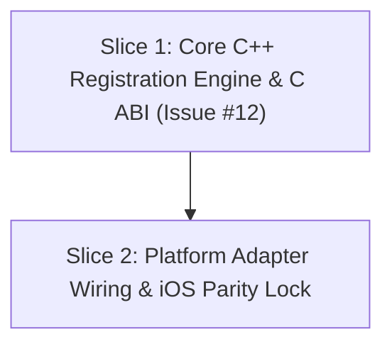

# Plan: SIP Account Registration & Presence (`account-registration`)

**Goal**: Implement the account registration and presence state machine in the portable C++17 core (`sip_core`), export flat C ABI functions for registration and unregistration, negotiate MD5 digest challenges against Asterisk PBX, marshal typed state callbacks to the platform main UI thread, and verify end-to-end zero-regression parity across iOS and Simulator test suites.

## Global Constraints

- **Language Standard**: C++17 for `sip_core`; pure C11 `extern "C"` interface for `sip_abi.h` with zero C++ name mangling, standard library types, or compiler-dependent ABIs.
- **Symbol Visibility**: `-fvisibility=hidden` on all core source files; only functions prefixed with `sip_*` are exported publicly with default visibility (`SIP_ABI_EXPORT`).
- **Network & Socket ABI Safety**: All CMake targets must configure `-DUSE_UNIXSOCK=ON` to match the layout of `struct sa` and `struct sip_msg` in `libre` and prevent silent registration hangs.
- **Threading Model**: Dedicated background worker thread invoking `re_main()`; all public C ABI calls from arbitrary caller threads must dispatch onto the worker thread via libre `mqueue` message queues without blocking the UI thread.
- **UI Thread Dispatch**: Registration callbacks (`on_reg_state`) must be marshaled to the platform main UI thread (`dispatch_get_main_queue()` on Apple targets or via `dispatch_to_main` hook).
- **Preserved Compatibility**: Zero regressions against existing iOS test harnesses (`scripts/verify-ios-video-tests.sh`, `scripts/verify-spm-video-sdk.sh`, `scripts/verify-sim-app-launch.sh`).

---

## 1. Frame

### Problem
In the initial codebase, SIP Address of Record (AOR) formatting, MD5 digest challenge negotiation, registration refresh timers, unregistration sequences, and UI thread event marshaling were embedded inside the iOS-specific Objective-C++ adapter (`Sources/SipSdk/SipClientBaresipV4.mm`). Moving to a cross-platform architecture requires extracting this registration and presence state machine into the portable C++17 core (`sip_core`) behind the clean, pure C ABI (`sip_abi`), while ensuring that all platform consumers receive thread-safe, main-thread-marshaled registration status events.

### Solution
Extract the account registration subsystem into `sip_core::Engine`:
1. Encapsulate `struct ua*` and `struct account*` allocation, formatting SIP AORs (`sip:<user>@<domain>:<port>[;transport=<transport>]`), and setting digest authentication credentials.
2. Hook Baresip's event dispatcher (`bevent_register`) to track `BEVENT_REGISTERING`, `BEVENT_REGISTER_OK`, `BEVENT_REGISTER_FAIL`, and `BEVENT_UNREGISTERING`, extracting SIP status codes and reason phrases.
3. Export pure C ABI functions `sip_client_register`, `sip_client_unregister`, and `sip_client_is_registered` with zero C++ type leakage.
4. Marshal all `on_reg_state` callbacks to the platform main UI thread (`dispatch_async` on Apple or caller-provided `dispatch_to_main` callback).
5. Wire `Sources/SipSdk/SipClientBaresipV4.mm` to the C ABI, verifying 100% zero-regression parity across the iOS test suite and Asterisk PBX.

### User Stories
- **US5 (Register)**: As a VoIP user, I want to register my SIP account with username, domain, password, transport (UDP/TCP), and port, so that I can send and receive calls through my SIP registrar.
- **US6 (MD5 Digest Auth)**: As a VoIP user, I want the SDK to handle digest authentication and nonce challenges automatically, so that I do not need to parse or compute HTTP/SIP authentication headers manually.
- **US7 (State Events)**: As an application developer, I want to receive typed registration state events (`Unregistered`, `Registering`, `Registered`, `Failed`) with status codes and reason strings, so that I can update the app's connection badge in the UI.
- **US8 (Unregister)**: As a VoIP user, I want to unregister my account on demand, so that the SIP proxy stops routing incoming calls to my device when I go offline.
- **US9 (Keep-Alive Refresh)**: As a mobile app developer, I want the SDK to handle automatic re-registration refreshes before registration expiry, so that my account remains reachable while the application is active.
- **US37 (Main Thread Guarantee)**: As an SDK consumer, I want all event delegate callbacks to be dispatched directly on the platform's main UI thread, so that I never encounter multithreaded UI state corruption crashes.

### Out of Scope
1. SIP over TLS (`USE_OPENSSL=ON`) or SIPS registration (deferred to a dedicated security milestone).
2. Multiple simultaneous registered accounts on a single `sip_client_t` instance (single account per client instance in Phase 1).
3. Audio or video call initiation and media negotiation (covered in Slices 3 and 4, Issues #13 and #14).
4. Custom SIP PUBLISH presence XML documents.

### Implementation Decisions
- **`core/include/sip_abi.h`**: Add `sip_client_register`, `sip_client_unregister`, `sip_client_is_registered`, and `dispatch_to_main` in `sip_callbacks_t`.
- **`core/src/engine.h` & `core/src/engine.cpp`**: Store active `struct ua *m_ua`, implement `register_account(user, domain, pwd, transport, port)` and `unregister_account()` executed on the worker thread via `post_task`. In `ua_event_handler`, intercept registration events, extract `scode` and `reason` from `struct sip_msg` via `bevent_get_msg`, and dispatch `on_reg_state` through `dispatch_to_main` or `dispatch_async(dispatch_get_main_queue(), ...)`.
- **`core/src/sip_abi.cpp`**: Forward `sip_client_register`, `sip_client_unregister`, and `sip_client_is_registered` to `sip_core::Engine`.
- **`core/tests/test_registration.cpp`**: Automated integration test verifying UDP registration with MD5 digest auth against local Asterisk PBX extension 1001, verifying `SIP_REG_STATE_REGISTERING` -> `SIP_REG_STATE_REGISTERED` (code 200, "OK"), wrong password rejection -> `SIP_REG_STATE_FAILED` (code 401), clean unregistration -> `SIP_REG_STATE_UNREGISTERED`, and main thread callback delivery.
- **`Sources/SipSdk/SipClientBaresipV4.mm`**: Refactor `-registry` and `-unregister` to call `sip_client_register` / `sip_client_unregister` through the C ABI, verifying that delegate events continue to drive the app UI.

### Testing Decisions
- **Asterisk PBX Integration**: Test connects to running Docker Asterisk 22 container (`127.0.0.1:5060`) for extension `1001` (password `test1001`), asserting real SIP challenge-response exchange.
- **Negative Testing**: Test wrong password (`wrongpass`) to assert transition to `SIP_REG_STATE_FAILED` with SIP code 401.
- **Main Thread Assertion**: Callback checks `pthread_main_np()` (or `dispatch_assert_queue(dispatch_get_main_queue())`) to guarantee main thread delivery.
- **iOS Parity Regression**: Re-run `scripts/verify-ios-video-tests.sh` and `scripts/verify-sim-app-launch.sh` to ensure zero regressions in the existing mobile app.

---

## 2. Seam

The test seams attach at:
1. **Primary Seam**: Universal C ABI Boundary (`core/include/sip_abi.h` and static library `libsipcore.a`) exercised by `core/tests/test_registration.cpp`.
2. **Platform Seam**: High-level Objective-C++ SDK interface (`Sources/SipSdk/include/SipClient.h`) exercised by `Tests/SipSdkRunner/main.mm` on iOS Simulator.

---

## 3. Vertical Slices

### Slice 1 — Core C++ Registration Engine, C ABI & Asterisk PBX Verification
- **User stories covered**: US5, US6, US7, US8, US9, US37
- **Device tier**: iOS Simulator (`arm64`) & macOS host compilation tier
- **Files**:
  - `core/include/sip_abi.h`
  - `core/src/engine.h`
  - `core/src/engine.cpp`
  - `core/src/sip_abi.cpp`
  - `core/CMakeLists.txt`
  - `core/tests/test_registration.cpp`
  - `scripts/verify-account-registration.sh`
- **Interfaces**:
  - `int sip_client_register(sip_client_t *client, const char *user, const char *domain, const char *pwd, const char *transport, int port);`
  - `int sip_client_unregister(sip_client_t *client);`
  - `bool sip_client_is_registered(const sip_client_t *client);`
  - Callback: `void (*on_reg_state)(sip_client_t *client, sip_reg_state_t state, int code, const char *reason, void *user_data);`
  - Dispatcher hook: `void (*dispatch_to_main)(void (*task)(void *arg), void *arg, void *user_data);`
- **Acceptance criteria**:
  1. **Given** an initialized `sip_client_t`, **when** `sip_client_register(client, "1001", "127.0.0.1", "test1001", "udp", 5060)` is invoked against Asterisk PBX, **then** `on_reg_state` transitions through `SIP_REG_STATE_REGISTERING` to `SIP_REG_STATE_REGISTERED` (code 200, reason "OK") via successful MD5 digest authentication, and `sip_client_is_registered(client)` returns `true`.
  2. **Given** an active registration, **when** keep-alive registration refresh timers trigger, **then** the core refreshes registration with the registrar without dropping into failed state.
  3. **Given** an initialized `sip_client_t` registering with an invalid password, **when** `sip_client_register(client, "1001", "127.0.0.1", "wrong_pwd", "udp", 5060)` is called, **then** `on_reg_state` fires `SIP_REG_STATE_FAILED` with SIP status code 401 ("Unauthorized").
  4. **Given** a registered `sip_client_t`, **when** `sip_client_unregister(client)` is called, **then** a SIP REGISTER with `Expires: 0` is sent, `on_reg_state` fires with `SIP_REG_STATE_UNREGISTERED`, and `sip_client_is_registered(client)` returns `false`.
  5. **Given** an environment with main thread dispatch enabled, **when** `on_reg_state` callbacks arrive, **then** every callback executes on the designated main UI thread.
- **Verify**: `bash scripts/verify-account-registration.sh`
- **Blocked-by**: None (Issue #11 is resolved)

---

### Slice 2 — Platform Adapter Wiring & Zero-Regression iOS Parity
- **User stories covered**: US5, US7, US8, US37
- **Device tier**: iOS Simulator (`arm64`)
- **Files**:
  - `Sources/SipSdk/SipClientBaresipV4.mm`
  - `Tests/SipSdkRunner/main.mm`
- **Interfaces**:
  - Consumes: `sip_client_register`, `sip_client_unregister`, `sip_client_is_registered`, `sip_callbacks_t.on_reg_state` from `sip_abi.h`
  - Produces: `-[SipClient registry]`, `-[SipClient unregister]`, `-[SipClient isRegistered]`, `SipClientDelegate` protocol events
- **Acceptance criteria**:
  1. **Given** `SipClient` configured with valid account credentials, **when** `[client registry]` is called, **then** it delegates to `sip_client_register` in `sip_core` and triggers `onWillRegister:` and `onDidRegister:` on `SipClientDelegate`.
  2. **Given** a registered `SipClient`, **when** `[client unregister]` is called, **then** it delegates to `sip_client_unregister` in `sip_core` and triggers `onWillUnRegister:`.
  3. **Given** the entire automated iOS test suite and app build, **when** `bash scripts/verify-ios-video-tests.sh` and `bash scripts/verify-sim-app-launch.sh` are run, **then** all existing video loopback, CallKit, and in-call screen tests pass with zero regressions.
- **Verify**: `bash scripts/verify-ios-video-tests.sh && bash scripts/verify-sim-app-launch.sh`
- **Blocked-by**: Slice 1

---

## 4. Waves & Dependencies

- **Wave 1**: Slice 1 (`core/include/sip_abi.h`, `core/src/engine.h`, `core/src/engine.cpp`, `core/src/sip_abi.cpp`, `core/CMakeLists.txt`, `core/tests/test_registration.cpp`, `scripts/verify-account-registration.sh`)
- **Wave 2**: Slice 2 (`Sources/SipSdk/SipClientBaresipV4.mm`, `Tests/SipSdkRunner/main.mm`)

---

## 5. Review & Refutation Checklist

- [x] All 6 user stories for Issue #12 (US5, US6, US7, US8, US9, US37) are covered.
- [x] Slice 1 touches exactly 4 production files (`sip_abi.h`, `engine.h`, `engine.cpp`, `sip_abi.cpp`), satisfying the surgical write set limit.
- [x] Slice 2 touches 1 production file (`SipClientBaresipV4.mm`) and 1 test file (`main.mm`).
- [x] Every slice specifies exact file paths, explicit function signatures, observable Given/When/Then acceptance criteria, and exact verification commands.
- [x] Zero placeholders (no TODO, TBD, or unverified error handling).
- [x] ABI safety rules (`-DUSE_UNIXSOCK=ON`, symbol visibility `-fvisibility=hidden`, C11 `extern "C"`) preserved verbatim.
- [x] Baseline test verification confirmed passing prior to plan creation.
