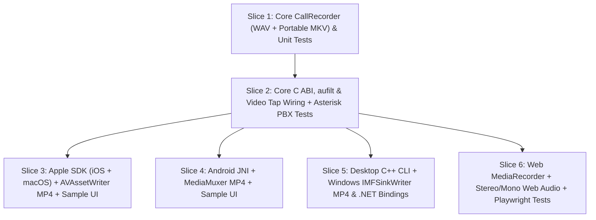

# Implementation Plan: Local Call Recording (`call-recording`)

**Goal:** Deliver stereo/mono WAV audio recording in `core/`, native MP4 video+audio recording on Apple/Android/Windows (plus portable MKV fallback on Linux/Desktop), Web `MediaRecorder` support, and full 6-platform parity.

**Spec & ADR:**
- [spec.md](./spec.md)
- [ADR 0008](../../docs/adr/0008-core-aufilt-wav-and-pluggable-video-recorder.md)

---

## 1. Seam Map

| Layer | Seam / Boundary | Test Harness |
| :--- | :--- | :--- |
| **Core Recorder & Writers** | `core/src/call_recorder.{h,cpp}`, `core/src/mkv_writer.{h,cpp}` | `ctest --test-dir .build/desktop -R core_call_recorder` |
| **Core C ABI & Engine** | `core/include/sip_abi.h`, `core/src/engine.cpp`, `core/src/media_driver.cpp`, `core/src/call_session.{h,cpp}` | `ctest --test-dir .build/desktop -R sip_core` |
| **Apple SDK (iOS + macOS)** | `AppleMediaRecorder`, `SipClient.swift`, `SipCall.swift`, `SipMacClient.mm` | `bash scripts/verify-ios-video-tests.sh && bash scripts/verify-macos-gui.sh` |
| **Android SDK** | `AndroidMediaRecorder.kt`, `sip_jni.cpp`, `SipClient.kt`, `SipCall.kt` | `bash scripts/verify-android-sdk.sh` |
| **Desktop C++ & Windows .NET** | `platforms/desktop/`, `platforms/windows/` (`IMFSinkWriter` + .NET bindings) | `bash scripts/verify-desktop-sdk.sh && bash scripts/verify-windows-sdk.sh` |
| **Web SDK** | `platforms/web/src/sipsdk.js`, `platforms/web/sample/` | `bash scripts/verify-web-sdk.sh --pbx` |

---

## 2. Vertical Slices

---

### Slice 1: Core `CallRecorder` (WAV + Portable MKV) & Unit Tests
- **Files:** `core/src/call_recorder.h`, `core/src/call_recorder.cpp`, `core/src/mkv_writer.h`, `core/src/mkv_writer.cpp`, `core/CMakeLists.txt`, `core/tests/test_call_recorder.cpp`
- **Verify:** `cmake --build .build/desktop --target sip_core_call_recorder_test && ctest --test-dir .build/desktop -R core_call_recorder --output-on-failure`

### Slice 2: Core C ABI, `aufilt` + Video Frame Tap & Live PBX Tests
- **Files:** `core/include/sip_abi.h`, `core/src/sip_abi.cpp`, `core/src/engine.{h,cpp}`, `core/src/call_session.{h,cpp}`, `core/src/media_driver.{h,cpp}`, `core/tests/test_audio_call.cpp`
- **Verify:** `cmake --build .build/desktop --target sip_core_audio_call_test && ctest --test-dir .build/desktop -R sip_core_audio_call_test --output-on-failure`

### Slice 3: Apple SDK (iOS + macOS) + `AVAssetWriter` MP4 + Sample UI
- **Files:** `platforms/ios/Sources/SipSdk/AppleMediaRecorder.swift`, `SipClient.swift`, `SipCall.swift`, `platforms/ios/Tests/SipSdkTests/`, `platforms/ios/sample/SipPhone/`, `platforms/macos/sample/SipSdkMac/`
- **Verify:** `bash scripts/verify-ios-video-tests.sh && bash scripts/verify-macos-gui.sh`

### Slice 4: Android JNI + `MediaMuxer` MP4 + Sample UI
- **Files:** `platforms/android/sipsdk/` (`AndroidMediaRecorder.kt`, `sip_jni.cpp`, `SipClient.kt`, `SipCall.kt`, `SipClientListener.kt`), `platforms/android/sample/`
- **Verify:** `bash scripts/verify-android-sdk.sh`

### Slice 5: Desktop C++ CLI + Windows `IMFSinkWriter` MP4 & .NET Bindings
- **Files:** `platforms/desktop/`, `platforms/windows/src/`, `platforms/windows/dotnet/`, `platforms/windows/sample/`
- **Verify:** `bash scripts/verify-desktop-sdk.sh && bash scripts/verify-windows-sdk.sh`

### Slice 6: Web `MediaRecorder` + Stereo/Mono Web Audio + Playwright Tests
- **Files:** `platforms/web/src/sipsdk.js`, `platforms/web/test/`, `platforms/web/sample/`
- **Verify:** `bash scripts/verify-web-sdk.sh --pbx`
