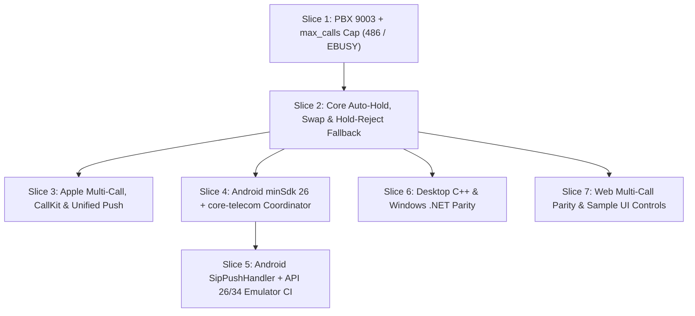

# Implementation Plan: Enterprise Telephony (`enterprise-telephony`)

**Goal:** Deliver multi-call lines (auto-hold, swap, call waiting, configurable `max_calls` cap with `486 Busy Here` / `EBUSY`), Apple CallKit multi-group parity, Android `SipTelecomManagerCoordinator` (`core-telecom` 1.0.1, `minSdk 26`), and `SipPushHandler` across the C++20 core and all platform SDKs.

**Global Constraints & Floors:**
- Platform Floors: iOS 17.0+, macOS 14.0+, Android API 26+ (`minSdk = 26`, `core-telecom:1.0.1`), Windows 10/11 (.NET 8), Modern Linux (Ubuntu 22.04+), Web (Chrome/Playwright).
- C/C++ Standard: C++20 (`core/`), ANSI C ABI boundary (`core/include/sip_abi.h`).
- Core-Enforced Single Audio-Active Call (ADR 0006): Answering, dialing, or resuming a call first sends a hold re-INVITE for any currently audio-active call. If the hold re-INVITE fails, the core still stops local audio send and playout for the old call, reports the hold error via `on_call_media`, and proceeds with the new call.
- Concurrent Call Cap (`max_calls`): Account setting `max_calls`, default `4`, range `1..8`, mapped to libbaresip `config.call.max_calls`. A call counts from creation until `SIP_CALL_STATE_CLOSED`. Over cap: incoming `INVITE` is answered `486 Busy Here` and fires `on_call_rejected_busy(caller_uri)`; `sip_call_dial` returns `EBUSY` (and `sip_call_make` sets `errno = EBUSY` and returns `nullptr`).
- Unified Push Payload Keys: Primary keys `sip_call_id` (alias `call_id`), `caller_uri` (aliases `from_uri`, `from`), `display_name` (alias `caller_name`), `has_video` (alias `video`), treating `sip_call_id` as an opaque SIP `Call-ID` string.
- No Firebase / No Server Gateway: `SipPushHandler.handleIncomingCallPush(data: Map<String, String>)` has zero Firebase dependency.

---

## 1. Frame

### Problem
`SipSdk` currently allows an arbitrary number of uncoordinated calls with no `max_calls` enforcement, does not automatically hold an active call when answering/dialing/resuming another, keeps Android on `minSdk 21` without system Telecom UI or push wake-up coordination, and sets iOS CallKit `maximumCallGroups` without tying it to `max_calls`.

### Solution
1. Add delayed callback extension `9003` to Docker Asterisk so single-process tests can trigger real incoming calls and `486 Busy Here` at `max_calls`.
2. Implement `max_calls` enforcement, `sip_call_dial`, `on_call_rejected_busy`, core-enforced auto-hold/swap, and failed-hold local audio teardown in `core/`.
3. Update Apple (`SipClient`, `SipCallKitCoordinator`, `SipPushRegistry`, and `SipSdkMac`) for multi-call groups and unified push keys.
4. Raise Android `minSdk` to 26, wire `androidx.core:core-telecom:1.0.1` via `SipTelecomManagerCoordinator`, and implement `SipPushHandler` with dual API 26 + API 34 emulator CI verification.
5. Propagate multi-call config, `EBUSY`, and `on_call_rejected_busy` to Desktop C++, Windows .NET, and Web (`sipsdk.js`), and add multi-line switching UI to sample apps.

### User Stories
1. **US1 (Call Waiting & Auto-Hold):** As a user on an active call, when I answer an incoming call or dial a second party, my first call automatically goes on hold without audio bleed.
2. **US2 (Hold & Swap):** As a user with two calls, resuming the held call automatically holds the active one so only one call has live audio at any time.
3. **US3 (Failed Hold Fallback):** As a user whose peer rejects a hold re-INVITE, my client still mutes/stops local audio for that call, notifies the app of the hold error, and connects the new call.
4. **US4 (Concurrent Call Cap):** As an integrator, I can configure `max_calls` (`1..8`, default `4`); dialing beyond the cap fails with `EBUSY`, and incoming calls over the cap receive `486 Busy Here` and fire `on_call_rejected_busy`.
5. **US5 (iOS CallKit Multi-Call):** As an iOS user, CallKit allows `max_calls` independent call groups and maps system "Hold & Accept" and swap actions to the core rules.
6. **US6 (Android System Calling):** As an Android user (API 26+), outgoing and incoming SIP calls integrate with system Telecom UI, lock-screen controls, Bluetooth/speaker/earpiece routing, and Hold & Accept via `core-telecom`.
7. **US7 (Android Push Wake-up):** As an Android integrator, passing an FCM data map to `SipPushHandler.handleIncomingCallPush` immediately displays ringing Telecom UI, starts and registers `SipClient`, links the incoming `INVITE` by SIP `Call-ID`, or closes as missed after 10 s.
8. **US8 (Cross-Platform Parity):** As a developer on macOS, Desktop C++, Windows .NET, or Web, I get the same `max_calls`, auto-hold, swap, `EBUSY`, and busy-rejection semantics.

### Out of Scope
- Multiple SIP accounts per `SipClient` (`m_ua` remains single-account).
- Merging calls / 3-way local audio mixing (Phase 3).
- Bundling Firebase (`firebase-messaging`) inside `sipsdk.aar`.
- Android system calling UI below API 26.
- VP8 / H.265 codecs (Phase 3).

### Implementation Decisions
- **Core C ABI Backwards Compatibility:** Keep `sip_call_make` (setting `errno = EBUSY` and returning `nullptr` at cap) and add `sip_call_dial` returning `int` (`0`, `EBUSY`, `EINVAL`, `EIO`).
- **Explicit `486` Enforcement in `BEVENT_SIPSESS_CONN`:** Check open call count in `m_all_calls` before calling `ua_accept`; if `>= max_calls`, reply `486 Busy Here` via `sip_treply` and invoke `on_call_rejected_busy`. Also set `conf_config()->call.max_calls = max_calls`.
- **Android `SipTelecomManagerCoordinator` Abstraction (ADR 0005):** Hide `androidx.core.telecom.CallsManager` behind a thin coordinator interface so a future move to raw `ConnectionService` touches one class.
- **Independent Verification Waves:** Core slices (1–2) run sequentially, then platform slices (3, 4, 6, 7) can execute cleanly in parallel waves, followed by Slice 5 (Android push + dual API 26/34 emulator verification).

### Testing Decisions
- **Seam:** Core C ABI (`core/include/sip_abi.h`) + Docker Asterisk 22 PBX (`9001` Echo, `9002` MusicOnHold, `9003` delayed callback), plus an in-process raw UDP SIP socket for negative re-INVITE rejection tests, JsSIP fake/PBX tests for Web, and API 26 + API 34 Google APIs emulators for Android.

---

## 2. Seam Map

| Layer | Seam / Boundary | Test Harness |
| :--- | :--- | :--- |
| **PBX Environment** | `docker/asterisk/config/extensions.conf` (`9001`, `9002`, `9003`) | `bash scripts/verify-pbx.sh` |
| **Core C ABI** | `core/include/sip_abi.h`, `core/src/engine.cpp` | `ctest --test-dir .build/desktop -R sip_core` |
| **Apple Native SDK** | `SipClient.swift`, `SipCallKitCoordinator.swift`, `SipPushRegistry.swift` | `bash scripts/verify-ios-video-tests.sh` & `verify-macos-gui.sh` |
| **Android SDK** | `SipTelecomManagerCoordinator.kt`, `SipPushHandler.kt`, `sip_jni.cpp` | `bash scripts/verify-android-sdk.sh` (API 26 + API 34) |
| **Desktop C++ & Windows .NET** | `platforms/desktop/`, `platforms/windows/dotnet/` | `bash scripts/verify-desktop-sdk.sh` & `verify-windows-sdk.sh` |
| **Web SDK** | `platforms/web/src/sipsdk.js` | `bash scripts/verify-web-sdk.sh --pbx` |

---

## 3. Vertical Slices



---

### Slice 1: Asterisk Callback (`9003`) + Core `max_calls` Cap (`486 Busy Here` / `EBUSY`)
* **Goal:** Add Asterisk delayed-callback extension `9003` and enforce configurable `max_calls` (`1..8`, default `4`) in `core/` with `sip_call_dial` (`EBUSY`), `486 Busy Here` incoming rejection, and `on_call_rejected_busy`.
* **Files:**
  * `docker/asterisk/config/extensions.conf`
  * `scripts/verify-pbx.sh`
  * `core/include/sip_abi.h`
  * `core/src/engine.h`
  * `core/src/engine.cpp`
  * `core/src/sip_abi.cpp`
  * `core/tests/test_audio_call.cpp`
* **Interfaces:**
  * `sip_account_config_t`: `int max_calls;` (`0` defaults to `4`, clamped `1..8`).
  * `sip_callbacks_t`: `void (*on_call_rejected_busy)(sip_client_t *client, const char *caller_uri, void *user_data);`
  * `SIP_ABI_EXPORT int sip_call_dial(sip_client_t *client, const char *target_uri, bool with_video, sip_call_t **out_call);`
* **Acceptance Criteria:**
  * Given `max_calls = 1` and an active call to `9001`, when calling `sip_call_dial`, then it returns `EBUSY` and sets `out_call = nullptr` (and `sip_call_make` sets `errno = EBUSY` and returns `nullptr`).
  * Given `max_calls = 1`, when `9003` originates an incoming `INVITE` while `9001` is active, then the core replies `486 Busy Here` without invoking `on_incoming_call` and invokes `on_call_rejected_busy` with the caller URI.
  * Given an existing call transitions to `SIP_CALL_STATE_CLOSED`, when calling `sip_call_dial` again, then a new call succeeds.
* **Verify:**
  ```bash
  bash scripts/verify-pbx.sh && cmake --build .build/desktop --target sip_core_audio_call_test && ctest --test-dir .build/desktop -R sip_core_audio_call_test --output-on-failure
  ```
* **Blocked-by:** None.

---

### Slice 2: Core Auto-Hold, Swap & Rejected-Hold Local Audio Fallback
* **Goal:** Enforce one audio-active call in `core/` on dial, answer, and resume (swap), stop local audio send/playout + notify `on_call_media` if a hold re-INVITE is rejected, and match concurrent outgoing `sip_call_t` sessions accurately.
* **Files:**
  * `core/src/engine.cpp`
  * `core/src/call_session.h`
  * `core/src/call_session.cpp`
  * `core/tests/test_audio_call.cpp`
* **Interfaces:**
  * `Engine::make_call` / `Engine::answer_call` / `Engine::hold_call(call, false)` first hold any other non-closed, non-held call via `call_hold(old_call, true)` before proceeding.
  * If `call_hold(old_call, true)` fails or peer rejects the hold re-INVITE, core stops local audio send/playout on `old_call` (`audio_stop` / `audio_mute` + local hold flag), emits `on_call_media` with hold/error state, and proceeds with the new call.
* **Acceptance Criteria:**
  * Given call A established on `9001`, when dialing call B to `9002` (or answering incoming call B), then call A transitions to `SIP_CALL_STATE_HOLD` before call B connects audio.
  * Given call A on hold and call B established, when calling `sip_call_set_hold(call_a, false)`, then call B moves to `SIP_CALL_STATE_HOLD` and call A resumes `SIP_CALL_STATE_ESTABLISHED`.
  * Given an in-process loopback peer that rejects hold re-INVITEs (`488` / `500`), when dialing call B while call A is active, then local audio stops for call A, `on_call_media` fires, and call B connects.
* **Verify:**
  ```bash
  cmake --build .build/desktop --target sip_core_audio_call_test && ctest --test-dir .build/desktop -R sip_core_audio_call_test --output-on-failure
  ```
* **Blocked-by:** Slice 1.

---

### Slice 3: Apple SDK Multi-Call, CallKit `maximumCallGroups` & Unified Push Keys
* **Goal:** Expose `maxCalls`, `onCallRejectedBusy`, and `EBUSY` on `SipClient` (`platforms/ios` + `platforms/macos`), update `SipCallKitCoordinator` (`maximumCallGroups = maxCalls`, hold/swap mapping), and align `SipPushRegistry` with the unified push payload keys.
* **Files:**
  * `platforms/ios/Sources/SipSdk/SipTypes.swift`
  * `platforms/ios/Sources/SipSdk/SipClient.swift`
  * `platforms/ios/Sources/SipSdk/CallKit/SipCallKitCoordinator.swift`
  * `platforms/ios/Sources/SipSdk/Push/SipPushRegistry.swift`
  * `platforms/ios/Tests/SipSdkTests/SipSdkTests.swift`
  * `platforms/macos/sample/SipSdkMac/Bridge/SipMacClient.h`
  * `platforms/macos/sample/SipSdkMac/Bridge/SipMacClient.mm`
* **Interfaces:**
  * `SipAccount.maxCalls: Int` (default `4`).
  * `SipClient.onCallRejectedBusy: ((String) -> Void)?`, `SipError.busy`.
  * `SipCallKitCoordinator(localizedName:client:maxCalls:)` sets `config.maximumCallGroups = maxCalls`, `config.maximumCallsPerCallGroup = 1`.
  * `SipIncomingPushPayload` adds `sipCallId: String?` and parses `sip_call_id`/`call_id`, `caller_uri`/`from_uri`/`from`, `display_name`/`caller_name`, `has_video`/`video`.
* **Acceptance Criteria:**
  * Given `SipCallKitCoordinator(maxCalls: 4)`, when inspecting `provider.configuration`, then `maximumCallGroups == 4`, `maximumCallsPerCallGroup == 1`, and `CXSetHeldCallAction` maps cleanly to `call.setHold`.
  * Given two concurrent iOS Simulator calls to `9001` and `9002`, when swapping via `setHold(false)`, then only one call remains un-held; over `maxCalls`, `makeCall` throws `SipError.busy` and incoming over cap triggers `onCallRejectedBusy`.
  * Given a push payload with `sip_call_id`, `from_uri`, `display_name`, and `has_video`, `SipPushRegistry` parses all fields accurately.
* **Verify:**
  ```bash
  bash scripts/verify-ios-video-tests.sh && bash scripts/verify-macos-gui.sh
  ```
* **Blocked-by:** Slice 2.

---

### Slice 4: Android `minSdk 26`, Multi-Call JNI & `SipTelecomManagerCoordinator`
* **Goal:** Raise Android `minSdk` to `26`, expose `maxCalls` / `EBUSY` / `onCallRejectedBusy` over JNI, and implement `SipTelecomManagerCoordinator` over `androidx.core:core-telecom:1.0.1` (`CallsManager`).
* **Files:**
  * `platforms/android/sipsdk/build.gradle.kts`
  * `platforms/android/sample/build.gradle.kts`
  * `platforms/android/sipsdk/src/main/AndroidManifest.xml`
  * `platforms/android/sipsdk/src/main/cpp/sip_jni.cpp`
  * `platforms/android/sipsdk/src/main/kotlin/com/sipsdk/SipClient.kt`
  * `platforms/android/sipsdk/src/main/kotlin/com/sipsdk/SipClientListener.kt`
  * `platforms/android/sipsdk/src/main/kotlin/com/sipsdk/SipTelecomManagerCoordinator.kt`
  * `platforms/android/sipsdk/src/test/kotlin/com/sipsdk/SipSdkUnitTest.kt`
  * `platforms/android/sipsdk/src/androidTest/kotlin/com/sipsdk/SipCallAudioTest.kt`
* **Interfaces:**
  * `SipClient.maxCalls: Int = 4`, `SipClientListener.onCallRejectedBusy(callerUri: String)`.
  * `SipTelecomManagerCoordinator` interface + `CoreTelecomCoordinator` implementation wrapping `CallsManager`: `addCall(...)`, `setActive(...)`, `setInactive(...)`, `disconnect(...)`, `requestEndpointChange(...)`, mapping answer/reject/hangup/hold/unhold/mute/DTMF/endpoint callbacks bidirectionally to `SipClient` & `SipCall`.
* **Acceptance Criteria:**
  * Given `sipsdk` Gradle configuration, when assembling AAR, then `minSdk` is `26` and `androidx.core:core-telecom:1.0.1` is resolved.
  * Given an outgoing call and an incoming call, `SipTelecomManagerCoordinator` registers both in `core-telecom` with matching state transitions (`dialing`, `ringing`, `active`, `held`, `disconnected`) and audio endpoint switching (`earpiece`, `speaker`, `bluetooth`, `wired`).
  * Given two calls on Android against Asterisk (`9001` & `9002`), answering or dialing the second auto-holds the first, swap leaves one un-held, and exceeding `maxCalls` triggers `486` + `onCallRejectedBusy` (and `EBUSY` error on `makeCall`).
* **Verify:**
  ```bash
  bash scripts/verify-android-sdk.sh
  ```
* **Blocked-by:** Slice 2.

---

### Slice 5: Android `SipPushHandler` & Dual API 26 / API 34 Emulator Verification
* **Goal:** Implement `SipPushHandler.handleIncomingCallPush(data: Map<String, String>)` with 10 s missed-call timeout and update `scripts/verify-android-sdk.sh` to boot and test on both API 26 and API 34 `google_apis/arm64-v8a` emulators.
* **Files:**
  * `platforms/android/sipsdk/src/main/kotlin/com/sipsdk/SipPushHandler.kt`
  * `platforms/android/sipsdk/src/main/kotlin/com/sipsdk/SipClient.kt`
  * `platforms/android/sipsdk/src/androidTest/kotlin/com/sipsdk/SipPushHandlerTest.kt`
  * `scripts/verify-android-sdk.sh`
* **Interfaces:**
  * `SipPushHandler.handleIncomingCallPush(context: Context, client: SipClient, data: Map<String, String>, timeoutMs: Long = 10_000L): SipPushCallHandle`
  * Matches incoming SIP `Call-ID` from `INVITE` against `sip_call_id` / `call_id`; fires `SipClientListener.onPushCallMissed(callId, callerUri)` on timeout and disconnects Telecom call.
* **Acceptance Criteria:**
  * Given a push map `{sip_call_id, caller_uri, display_name, has_video}`, when `handleIncomingCallPush` runs, then a ringing Telecom call appears immediately, `SipClient` registers, and an incoming `INVITE` with matching `Call-ID` attaches to that Telecom call.
  * Given a push map when no matching `INVITE` arrives within timeout, then the Telecom call disconnects as missed and `onPushCallMissed` fires.
  * Given `scripts/verify-android-sdk.sh`, when run on host, then it boots both API 34 and API 26 Google APIs emulators and passes `connectedDebugAndroidTest` on both.
* **Verify:**
  ```bash
  bash scripts/verify-android-sdk.sh
  ```
* **Blocked-by:** Slice 4.

---

### Slice 6: Desktop C++ & Windows .NET Multi-Call Parity
* **Goal:** Add `max_calls`, `on_call_rejected_busy`, and `EBUSY` handling to `platforms/desktop/` and `platforms/windows/dotnet/` with automated multi-call tests.
* **Files:**
  * `platforms/desktop/include/sip/types.hpp`
  * `platforms/desktop/include/sip/listener.hpp`
  * `platforms/desktop/include/sip/client.hpp`
  * `platforms/desktop/src/client.cpp`
  * `platforms/desktop/tests/test_desktop_lifecycle.cpp`
  * `platforms/windows/dotnet/src/SipSdk/Native/SipNativeAbi.cs`
  * `platforms/windows/dotnet/src/SipSdk/SipClient.cs`
  * `platforms/windows/dotnet/src/SipSdk/SipEventArgs.cs`
  * `platforms/windows/dotnet/tests/SipSdk.Tests/SipClientTests.cs`
* **Interfaces:**
  * Desktop C++: `AccountConfig::max_calls` (default `4`), `IClientListener::on_call_rejected_busy(const std::string &caller_uri)`, `Client::dial(...)` / `make_call` `EBUSY`.
  * Windows .NET: `SipAccountConfig.MaxCalls`, `SipClient.CallRejectedBusy` event, `SipNativeAbi.sip_call_dial` P/Invoke throwing `InvalidOperationException` / returning `EBUSY`.
* **Acceptance Criteria:**
  * Given Desktop C++ tests against Asterisk, when dialing two calls and swapping, then auto-hold and swap behave identically to `core/`; over `max_calls`, dial fails with `EBUSY` and `on_call_rejected_busy` fires on incoming `INVITE`.
  * Given Windows .NET unit/ABI tests, when invoking `sip_call_dial` and `MaxCalls` bindings, then all P/Invoke signatures and `CallRejectedBusy` callbacks pass.
* **Verify:**
  ```bash
  bash scripts/verify-desktop-sdk.sh && bash scripts/verify-windows-sdk.sh
  ```
* **Blocked-by:** Slice 2.

---

### Slice 7: Web SDK Multi-Call Parity & Sample App Multi-Line UI
* **Goal:** Implement `maxCalls`, auto-hold/swap, call waiting, `486 Busy Here` + `callRejectedBusy` in `platforms/web/src/sipsdk.js`, verify via Playwright + Asterisk, and add multi-line switching UI to sample apps.
* **Files:**
  * `platforms/web/src/sipsdk.js`
  * `platforms/web/test/fake-jssip.mjs`
  * `platforms/web/test/sipsdk.test.mjs`
  * `platforms/web/test/verify-web-sdk-pbx.mjs`
  * `platforms/web/sample/app.js`
  * `platforms/web/sample/index.html`
  * `platforms/ios/sample/SipPhone/Views/InCallView.swift`
  * `platforms/macos/sample/SipSdkMac/Views/InCallView.swift`
  * `platforms/android/sample/src/main/kotlin/com/sipsdk/sample/ui/InCallScreen.kt`
* **Interfaces:**
  * `SipClient.calls` (`ReadOnlyArray<SipCall>`), `account.maxCalls` (default `4`, `1..8`), `callRejectedBusy` event, `makeCall` throws `Error` with `.code === 'EBUSY'` at cap.
  * Incoming `RTCSession` over `maxCalls` is terminated with `486 Busy Here` and emits `callRejectedBusy`.
* **Acceptance Criteria:**
  * Given Web SDK unit + Playwright PBX tests, when two calls are active, then answering/dialing/resuming one auto-holds the other; over `maxCalls`, `makeCall` throws `EBUSY` and incoming over cap gets `486`.
  * Given iOS, macOS, Android, and Web sample UIs with two calls, when tapping a held line or Swap, then the active line switches cleanly.
* **Verify:**
  ```bash
  bash scripts/verify-web-sdk.sh --pbx && bash scripts/verify-ios-video-tests.sh && bash scripts/verify-macos-gui.sh
  ```
* **Blocked-by:** Slice 2, Slice 3, Slice 4.

---

## 4. Manual Physical Device Evidence (Before Final Release Sign-Off)
Capture logs/screenshots under `specs/enterprise-telephony/evidence/` from one physical Android device:
1. Lock-screen incoming call UI via `core-telecom`.
2. Bluetooth headset audio routing switch during an active call.
3. Real FCM wake-up from a killed app state (`SipPushHandler`).
