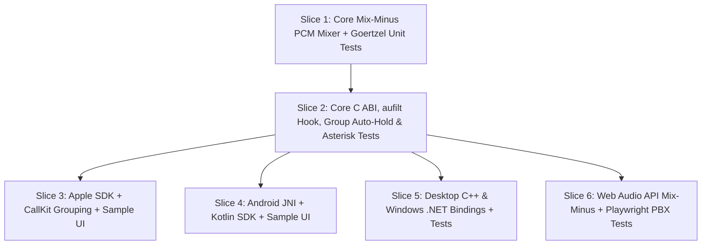

# Implementation Plan: Local Audio Conference (`local-audio-conference`)

**Goal:** Deliver client-side local audio conferencing (`2..max_calls` remote legs) with mix-minus audio mixing, group auto-hold/mute semantics, iOS CallKit grouping, and full 6-platform parity (`core/`, iOS, macOS, Android, Desktop C++, Windows .NET, Web).

**Spec & ADR:**
- [spec.md](./spec.md)
- [ADR 0007](../../docs/adr/0007-core-aufilt-mix-minus-conference.md) (extends [ADR 0006](../../docs/adr/0006-core-enforced-single-audio-call.md))

---

## 1. Seam Map

| Layer | Seam / Boundary | Test Harness |
| :--- | :--- | :--- |
| **Core Mixer Math** | `core/src/conference_mixer.{h,cpp}` | `ctest --test-dir .build/desktop -R core_conference_mixer` |
| **Core C ABI & Engine** | `core/include/sip_abi.h`, `core/src/engine.cpp`, `core/src/media_driver.cpp` | `ctest --test-dir .build/desktop -R sip_core` |
| **Apple SDK (iOS + macOS)** | `SipClient.swift`, `SipCall.swift`, `SipCallKitCoordinator.swift`, `SipMacClient.mm` | `bash scripts/verify-ios-video-tests.sh && bash scripts/verify-macos-gui.sh` |
| **Android SDK** | `sip_jni.cpp`, `SipClient.kt`, `SipCall.kt`, `SipClientListener.kt`, `InCallScreen.kt` | `bash scripts/verify-android-sdk.sh` (API 26 + API 34) |
| **Desktop C++ & Windows .NET** | `platforms/desktop/`, `platforms/windows/dotnet/` | `bash scripts/verify-desktop-sdk.sh && bash scripts/verify-windows-sdk.sh` |
| **Web SDK** | `platforms/web/src/sipsdk.js`, `platforms/web/sample/` | `bash scripts/verify-web-sdk.sh --pbx` |

---

## 2. Vertical Slices

---

### Slice 1: Core Mix-Minus PCM Mixer (`ConferenceMixer`) + Tone-Isolation Unit Tests
- **Goal:** Build a self-contained, thread-safe C++20 `ConferenceMixer` supporting `2..8` legs, linear resampling across mixed sample rates (8/16/48 kHz), local mute flag, and S16LE saturation clamping.
- **Files:**
  - `core/src/conference_mixer.h`
  - `core/src/conference_mixer.cpp`
  - `core/CMakeLists.txt`
  - `core/tests/test_conference_mixer.cpp`
- **Acceptance Criteria:**
  - Goertzel DFT test proves peer A TX has local (440 Hz) + peer B (1800 Hz) and suppresses peer A's own 1000 Hz by >= 30 dB.
  - Mixed sample rates (8 kHz leg + 48 kHz leg) preserve target tones without buffer underrun or overflow.
  - Local mute suppresses 440 Hz in all peer TX outputs while keeping 1000 Hz <-> 1800 Hz active.
- **Verify:** `cmake --build .build/desktop --target sip_core_conference_mixer_test && ctest --test-dir .build/desktop -R core_conference_mixer --output-on-failure`

---

### Slice 2: Core C ABI, Baresip `aufilt` Wiring, Group Auto-Hold & Live PBX Tests
- **Goal:** Register the `aufilt` plugin in `core/`, expose `sip_client_merge_calls`, `sip_client_add_to_conference`, `sip_client_split_call`, `sip_client_leave_conference`, `sip_call_is_in_conference`, and `on_conference_changed`, update ADR 0006 group hold/resume/mute rules, and pause video on merged legs.
- **Files:**
  - `core/include/sip_abi.h`
  - `core/src/sip_abi.cpp`
  - `core/src/engine.h`
  - `core/src/engine.cpp`
  - `core/src/call_session.h`
  - `core/src/call_session.cpp`
  - `core/src/media_driver.cpp`
  - `core/tests/test_audio_call.cpp`
- **Acceptance Criteria:**
  - Merging `9001` and `9002` keeps both `ESTABLISHED` with RTP flowing and `is_in_conference == true`.
  - Splitting one leg puts it on `HOLD` and dissolves the 1-leg remainder back to a normal `ESTABLISHED` call.
  - Dialing a 3rd call auto-holds both conference legs; resuming either conference leg resumes both and auto-holds the 3rd call.
- **Verify:** `bash scripts/verify-pbx.sh && cmake --build .build/desktop --target sip_core_audio_call_test && ctest --test-dir .build/desktop -R sip_core_audio_call_test --output-on-failure`

---

### Slice 3: Apple SDK (iOS + macOS), CallKit `supportsGrouping` & Sample UI
- **Goal:** Expose conference APIs on Swift `SipClient`/`SipCall` and `SipMacClient`, flip `supportsGrouping = true` and `maximumCallsPerCallGroup = maxCalls` in `SipCallKitCoordinator` with `CXSetGroupCallAction` support, and add Merge / Split UI in `SipPhone` and `SipSdkMac`.
- **Verify:** `bash scripts/verify-ios-video-tests.sh && bash scripts/verify-macos-gui.sh`

---

### Slice 4: Android JNI, Kotlin SDK & Sample UI
- **Goal:** Expose conference APIs over `sip_jni.cpp` and `SipClient.kt`/`SipCall.kt`/`SipClientListener.kt`, keep Telecom audio active during conference, add Merge / Split controls to `InCallScreen.kt`, and verify on API 26 + API 34 emulators.
- **Verify:** `bash scripts/verify-android-sdk.sh`

---

### Slice 5: Desktop C++ & Windows .NET Bindings + Tests
- **Goal:** Expose conference APIs and callbacks in `platforms/desktop/` and `platforms/windows/dotnet/` with unit/ABI and Asterisk tests.
- **Verify:** `bash scripts/verify-desktop-sdk.sh && bash scripts/verify-windows-sdk.sh`

---

### Slice 6: Web Audio API Mix-Minus (`platforms/web`) + Playwright PBX Tests
- **Goal:** Implement `mergeCalls` / `splitCall` / `leaveConference` / `conferenceChanged` in `platforms/web/src/sipsdk.js` via Web Audio API mix-minus + `RTCRtpSender.replaceTrack`, add Merge / Split UI to `platforms/web/sample/`, and verify with unit + Playwright Asterisk (`9001` + `9002`) tests.
- **Verify:** `bash scripts/verify-web-sdk.sh --pbx`
