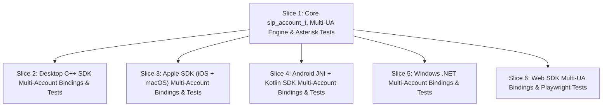

# Implementation Plan: Multi-Account Registration & Routing (`multi-account`)

**Goal:** Support `1..8` simultaneous SIP accounts (`sip_account_t`) per `SipClient` with per-account registration, dialing, incoming call attribution, SIP MESSAGE routing, cross-account auto-hold/conference, and full 6-platform parity while preserving 100% single-account backwards compatibility.

**Spec & ADR:**
- [spec.md](./spec.md)
- [ADR 0008](../../docs/adr/0008-multi-account-per-client.md)

---

## 1. Seam Map

| Layer | Seam / Boundary | Test Harness |
| :--- | :--- | :--- |
| **Core C ABI & Engine** | `core/include/sip_abi.h`, `core/src/account_session.{h,cpp}`, `core/src/engine.{h,cpp}`, `core/src/call_session.{h,cpp}`, `core/src/sip_abi.cpp` | `ctest --test-dir .build/desktop -R sip_core` |
| **Desktop C++ SDK** | `platforms/desktop/include/sip_sdk/`, `platforms/desktop/src/` | `bash scripts/verify-desktop-sdk.sh` |
| **Apple SDK (iOS + macOS)** | `platforms/ios/Sources/SipSdk/`, `platforms/macos/` | `bash scripts/verify-ios-video-tests.sh && bash scripts/verify-macos-gui.sh` |
| **Android SDK** | `platforms/android/sipsdk/src/main/cpp/sip_jni.cpp`, `SipAccount.kt`, `SipClient.kt`, `SipCall.kt` | `bash scripts/verify-android-sdk.sh` |
| **Windows .NET SDK** | `platforms/windows/dotnet/` | `bash scripts/verify-windows-sdk.sh` |
| **Web SDK** | `platforms/web/src/sipsdk.js`, `platforms/web/tests/` | `bash scripts/verify-web-sdk.sh --pbx` |

---

## 2. Vertical Slices

---

### Slice 1: Core `sip_account_t`, Multi-UA Engine & Live Asterisk Tests
- **Goal:** Replace single `m_ua` in `core::Engine` with a managed list of `sip_account_t` sessions (plus default account pointer), route all UA events, calls, transfers, conferences, transport resets, and SIP MESSAGE traffic by account, and prove all behaviors against Docker Asterisk (`1001` + `1003`).
- **Files:**
  - `core/include/sip_abi.h`
  - `core/src/account_session.h`
  - `core/src/account_session.cpp`
  - `core/src/call_session.h`
  - `core/src/call_session.cpp`
  - `core/src/engine.h`
  - `core/src/engine.cpp`
  - `core/src/sip_abi.cpp`
  - `core/CMakeLists.txt`
  - `core/tests/test_multi_account.cpp`
- **Verify:** `cmake --build .build/desktop --parallel && .build/desktop/core/sip_core_multi_account_test && .build/desktop/core/sip_core_registration_test && .build/desktop/core/sip_core_audio_call_test`

### Slice 2: Desktop C++ SDK Multi-Account Bindings & Tests
- **Goal:** Add `sip::Account` and multi-account methods/callbacks to `platforms/desktop/` and add a desktop multi-account test.
- **Verify:** `bash scripts/verify-desktop-sdk.sh`

### Slice 3: Apple SDK (iOS + macOS) Multi-Account Bindings & Tests
- **Goal:** Add `SipAccount` and multi-account methods/events to `platforms/ios/Sources/SipSdk/` and `platforms/macos/`, with automated tests.
- **Verify:** `bash scripts/verify-ios-video-tests.sh && bash scripts/verify-macos-gui.sh`

### Slice 4: Android JNI + Kotlin SDK Multi-Account Bindings & Tests
- **Goal:** Expose `SipAccount` and multi-account APIs over `sip_jni.cpp` and Kotlin SDK with unit/emulator tests.
- **Verify:** `bash scripts/verify-android-sdk.sh`

### Slice 5: Windows .NET Multi-Account Bindings & Tests
- **Goal:** Bind `sip_account_*` in `SipNativeAbi.cs`, add `SipAccount` and `SipClient` multi-account APIs, and add unit tests.
- **Verify:** `bash scripts/verify-windows-sdk.sh`

### Slice 6: Web SDK Multi-UA Bindings & Playwright Tests
- **Goal:** Support multiple JsSIP `UA` instances inside `platforms/web/src/sipsdk.js` with `addAccount` / `removeAccount` / `setDefaultAccount` / `dial` / `sendMessage`, and verify with unit + Playwright Asterisk tests.
- **Verify:** `bash scripts/verify-web-sdk.sh --pbx`
