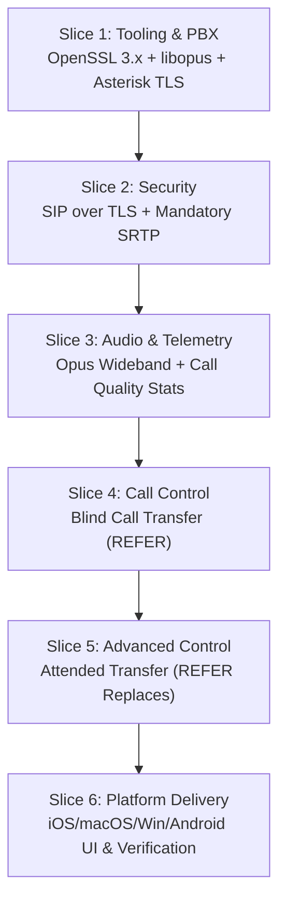

# Implementation Plan: Production Voice, Security & Call Control (`production-voice-security`)

**Goal:** Deliver enterprise-grade SIP over TLS (SIPS), mandatory SRTP encryption, wideband Opus audio with real-time call quality telemetry, and RFC 3515 blind/attended call transfer (`REFER`) across the C++20 core and all platform SDKs.

**Global Constraints & Floors:**
- Platform Floors: iOS 17.0+, macOS 14.0+, Android API 24+, Windows 10/11 (.NET 8), Modern Linux (Ubuntu 22.04+).
- C/C++ Standard: C++20 (`core/`), ANSI C ABI boundary (`sip_abi.h`).
- Cryptography: Static OpenSSL 3.x across all OS targets (`-DUSE_OPENSSL=ON`); no dynamic OpenSSL linkage or platform TLS divergences.
- Media Encryption: `media_enc` defaults to `"srtp-mand"` on TLS transports; `"none"` on plain UDP/TCP.
- Audio Codec Priority: `opus/48000/2` > `G722/16000/1` > `PCMU/8000/1` / `PCMA/8000/1`.
- Transfer Protocol: RFC 3515 (`REFER`) with `message/sipfrag` progress tracking via `NOTIFY`. Incoming `REFER` requires explicit application approval by default (`auto_accept = false`).

---

## 1. Frame

### Problem
`SipSdk` currently operates without signaling and media encryption (`USE_OPENSSL=OFF`), lacks wideband Opus audio, provides no call quality diagnostics (jitter, bitrate, packet loss), and has no mechanism to transfer active calls. These gaps prevent deployment against standard enterprise PBXs, healthcare platforms, and telecom carriers requiring strict SIP-TLS and SRTP compliance.

### Solution
1. Statically compile OpenSSL 3.x and `libopus` into Baresip v4.12.0 and libre v4.12.0 prebuilts.
2. Extend `sip_abi.h` and the C++20 core engine to support TLS transports with certificate verification, CA certificate injection, and automatic `srtp-mand` media encryption.
3. Configure `libopus` as the default wideband audio codec and add a real-time call telemetry engine exposing bitrate, jitter, RTT, and packet loss via pull (`sip_call_get_stats`) and 2-second push callbacks (`on_call_stats`).
4. Implement RFC 3515 SIP `REFER` for blind and attended transfer (with `Replaces`), tracking transfer progression via `NOTIFY` `message/sipfrag` bodies.
5. Harmonize platform bindings across iOS (Swift), macOS, Android (Kotlin), Windows (C#), and Web (JsSIP).

### User Stories
1. **US1 (Encrypted Registration & Signaling):** As an enterprise user, I can register over `tls` on port 5061 with system or custom CA certificate validation, ensuring signaling privacy.
2. **US2 (Secure Media Streaming):** As a user on a TLS account, my audio and video streams automatically negotiate SDES-SRTP or DTLS-SRTP (`RTP/SAVP`), preventing eavesdropping and unencrypted media fallback.
3. **US3 (High-Definition Wideband Voice):** As a caller, my calls automatically negotiate the Opus codec at 48 kHz stereo/mono when supported by the peer/PBX for optimal voice clarity.
4. **US4 (In-Call Quality Telemetry):** As an application developer, I receive live metrics (bitrate, packet loss, jitter, RTT, negotiated codec) to display in-call network health HUDs.
5. **US5 (Blind Call Transfer):** As an operator, I can transfer an active call directly to a third-party extension (e.g., `1004`) via SIP `REFER` and have my call drop automatically when the transfer succeeds.
6. **US6 (Attended Call Transfer):** As an operator, I can consult with a colleague on a second line and transfer my primary held call to them with SIP `Replaces` negotiation.

### Out of Scope
- Mutual TLS (mTLS) with client certificates (deferred).
- Multi-party local conference mixing (deferred to Phase 3).
- Android `TelecomManager` / `ConnectionService` (deferred to Phase 2 `enterprise-telephony`).
- SIP presence, BLF, and MWI subscriptions (deferred).

### Implementation Decisions
- **Static OpenSSL 3.x vs Native Platform TLS:** Rejection of `Network.framework` / `SChannel` in favor of static OpenSSL 3.x to ensure identical TLS & SRTP behavior in libre across all five operating systems without custom C patches.
- **Fail-Safe SRTP Default:** `media_enc` defaults to `"srtp-mand"` whenever `transport == "tls"`. Calls reject unencrypted RTP fallback unless explicitly overridden.
- **Dual Telemetry Path:** Support both periodic push (`on_call_stats` every 2 s) and synchronous on-demand pull (`sip_call_get_stats`) so UI layers can drive their own frame renders or listen passively.
- **Explicit Transfer Acceptance:** Incoming `REFER` triggers `on_transfer_request` and requires explicit confirmation (`sip_call_accept_transfer`) to prevent toll-fraud and unintended call redirection.

### Testing Decisions
- **Seam:** Core C ABI (`sip_abi.h`) and Docker Asterisk 22 PBX container.
- **E2E Acceptance Suite:** Automated CTest (`test_registration`, `test_audio_call`), iOS Simulator runner (`verify-ios-video-tests.sh`), desktop runner (`verify-desktop-sdk.sh`), and web PBX runner (`verify-web-sdk.sh --pbx`).
- **Real-Run PBX Verification:** Docker Asterisk 22 container configured with TLS (port 5061), SDES-SRTP endpoint 1004, DTLS endpoint 1002, and transfer targets.

---

## 2. Seam Map

| Layer | Seam / Boundary | Test Harness |
| :--- | :--- | :--- |
| **PBX Environment** | Docker Asterisk 22 (`pjsip.conf`, `extensions.conf`) | `bash scripts/verify-pbx.sh` |
| **Core C ABI** | `core/include/sip_abi.h` | `ctest --test-dir .build/desktop` |
| **Apple Native SDK** | `SipClient.swift`, `SipCall.swift` | `bash scripts/verify-ios-video-tests.sh` |
| **macOS Native App** | `SipSdkMac.xcodeproj` | `bash scripts/verify-macos-gui.sh` |
| **Windows .NET SDK** | `SipClient.cs` | `bash scripts/verify-windows-sdk.sh` |
| **Android SDK** | `sipsdk.aar` (Kotlin/JNI) | `bash scripts/verify-android-sdk.sh` |
| **Web SDK** | `platforms/web/src/sipsdk.js` | `bash scripts/verify-web-sdk.sh --pbx` |

---

## 3. Vertical Slices



---

### Slice 1: OpenSSL 3.x & libopus Build Pipeline + Asterisk TLS/SRTP Setup
* **Goal:** Rebuild Baresip and libre across all platforms with static OpenSSL 3.x and `libopus` enabled (`-DUSE_OPENSSL=ON`), regenerate `Package.swift`, and configure Docker Asterisk with TLS 5061 and SRTP profiles.
* **Files:**
  * `scripts/build-baresip-xcframework.sh`
  * `scripts/build-baresip-desktop.sh`
  * `scripts/build-baresip-android.sh`
  * `scripts/build-baresip-windows.sh`
  * `docker/asterisk/config/pjsip.conf`
  * `docker/asterisk/config/extensions.conf`
  * `docker/asterisk/entrypoint.sh`
  * `Package.swift`
* **Interfaces:**
  * Build: Produces `libre.a` and `libbaresip.a` with OpenSSL (`tls_alloc`, `tls_add_ca`) and Opus (`exports_opus`) symbols.
  * Network: Asterisk binds `0.0.0.0:5061` (TLS) with generated self-signed RSA certificate and CA PEM.
* **Acceptance Criteria:**
  * Given the Asterisk Docker container starts, when querying PJSIP transports, then transport `transport-tls` is active on port 5061 and endpoint 1004 has `media_encryption=sdes`.
  * Given `BaresipCore.xcframework` and desktop static libraries, when running symbol audits (`nm -g`), then symbols for `tls_alloc`, `srtp_create`, and `exports_opus` are exported.
* **Verify:**
  ```bash
  bash scripts/verify-pbx.sh && nm -g .build/desktop/lib/libre.a | grep tls_alloc
  ```
* **Blocked-by:** None.

---

### Slice 2: Core C ABI & Security: SIP over TLS (SIPS) & Mandatory SRTP
* **Goal:** Add TLS account configuration, custom CA support, certificate verification controls, and automatic `srtp-mand` media encryption to the C++20 core and Swift SDK.
* **Files:**
  * `core/include/sip_abi.h`
  * `core/src/engine.cpp`
  * `core/src/call_session.cpp`
  * `core/src/call_session.hpp`
  * `core/tests/test_registration.cpp`
  * `core/tests/test_audio_call.cpp`
  * `platforms/ios/Sources/SipSdk/SipClient.swift`
  * `platforms/ios/Sources/SipSdk/SipTypes.swift`
* **Interfaces:**
  * `sip_account_config_t`:
    ```c
    const char *tls_ca_file;
    bool verify_tls_cert;       /* defaults to true */
    const char *media_enc;      /* "srtp-mand", "dtls_srtp", "none" */
    ```
* **Acceptance Criteria:**
  * Given a SIP account with `transport = "tls"` and port 5061, when registering against Asterisk with a valid CA, then registration state transitions to `SIP_REG_STATE_REGISTERED`.
  * Given a SIP account with `transport = "tls"` and `verify_tls_cert = true`, when registering against an untrusted certificate, then registration fails with TLS validation error.
  * Given an active TLS call, when SDP offer/answer exchanges, then media descriptor contains `RTP/SAVP` and crypto attributes, and audio frames transmit encrypted.
* **Verify:**
  ```bash
  ctest --test-dir .build/desktop -R test_registration && bash scripts/verify-ios-video-tests.sh
  ```
* **Blocked-by:** Slice 1.

---

### Slice 3: Wideband Audio (Opus / G.722) & Real-time Call Quality Stats
* **Goal:** Prioritize Opus audio negotiation in SDP and implement `sip_call_stats_t` telemetry with synchronous pull (`sip_call_get_stats`) and 2-second periodic push callback (`on_call_stats`).
* **Files:**
  * `core/include/sip_abi.h`
  * `core/src/call_session.cpp`
  * `core/src/call_session.hpp`
  * `core/src/engine.cpp`
  * `core/tests/test_audio_call.cpp`
  * `platforms/ios/Sources/SipSdk/SipCall.swift`
  * `platforms/ios/Sources/SipSdk/SipTypes.swift`
* **Interfaces:**
  * C ABI:
    ```c
    typedef struct sip_call_stats_t {
        char audio_codec[32];
        uint32_t audio_bitrate_kbps;
        float audio_loss_rate;
        uint32_t audio_jitter_ms;
        uint32_t audio_rtt_ms;
        char video_codec[32];
        uint32_t video_bitrate_kbps;
        float video_loss_rate;
        uint32_t video_jitter_ms;
        uint32_t video_fps;
    } sip_call_stats_t;

    SIP_ABI_EXPORT int sip_call_get_stats(const sip_call_t *call, sip_call_stats_t *stats);
    ```
  * Callback:
    ```c
    void (*on_call_stats)(sip_call_t *call, const sip_call_stats_t *stats, void *user_data);
    ```
* **Acceptance Criteria:**
  * Given an outgoing call to Asterisk `9001` (Echo), when SDP negotiation completes, then the negotiated audio codec is `"opus"`.
  * Given an established call exchanging audio, when calling `sip_call_get_stats`, then `audio_bitrate_kbps` is > 0 and `audio_codec` equals `"opus"`.
  * Given an active call session, when media flows for 4 seconds, then `on_call_stats` is invoked at least twice on the dispatcher thread.
* **Verify:**
  ```bash
  ctest --test-dir .build/desktop -R test_audio_call
  ```
* **Blocked-by:** Slice 2.

---

### Slice 4: Blind Call Transfer (SIP REFER)
* **Goal:** Implement blind call transfer via RFC 3515 SIP `REFER`, track progress via incoming `NOTIFY` with `message/sipfrag`, and support incoming transfer request delegation (`on_transfer_request` and `sip_call_accept_transfer`).
* **Files:**
  * `core/include/sip_abi.h`
  * `core/src/call_session.cpp`
  * `core/src/call_session.hpp`
  * `core/src/engine.cpp`
  * `core/tests/test_audio_call.cpp`
  * `platforms/ios/Sources/SipSdk/SipCall.swift`
* **Interfaces:**
  * C ABI:
    ```c
    SIP_ABI_EXPORT int sip_call_transfer(sip_call_t *call, const char *target_uri);
    SIP_ABI_EXPORT int sip_call_accept_transfer(sip_call_t *call, bool accept);
    ```
  * Callbacks:
    ```c
    void (*on_transfer_status)(sip_call_t *call, int code, const char *reason, void *user_data);
    void (*on_transfer_request)(sip_call_t *call, const char *refer_to_uri, bool has_replaces, void *user_data);
    ```
* **Acceptance Criteria:**
  * Given an active call with peer A, when calling `sip_call_transfer(call, "sip:1004@...")`, then a `REFER` request is sent with `Refer-To: <sip:1004@...>`.
  * Given a successful transfer negotiation, when peer A sends `NOTIFY` with `200 OK` in `message/sipfrag`, then `on_transfer_status` fires with code 200 and the original call terminates.
  * Given an incoming `REFER` with `auto_accept = false`, when received, then `on_transfer_request` fires and no outbound call is placed until `sip_call_accept_transfer` is called.
* **Verify:**
  ```bash
  ctest --test-dir .build/desktop -R test_audio_call
  ```
* **Blocked-by:** Slice 3.

---

### Slice 5: Attended Call Transfer (SIP REFER with Replaces)
* **Goal:** Implement attended call transfer linking two active sessions (held call and consultation call) via `REFER` with URL-escaped `Replaces` header parameter.
* **Files:**
  * `core/include/sip_abi.h`
  * `core/src/call_session.cpp`
  * `core/src/call_session.hpp`
  * `core/src/engine.cpp`
  * `core/tests/test_audio_call.cpp`
  * `platforms/ios/Sources/SipSdk/SipCall.swift`
* **Interfaces:**
  * C ABI:
    ```c
    SIP_ABI_EXPORT int sip_call_attended_transfer(sip_call_t *call, sip_call_t *consult_call);
    ```
* **Acceptance Criteria:**
  * Given call A (on hold) and call B (consultation active), when calling `sip_call_attended_transfer(call_a, call_b)`, then a `REFER` is sent to call A with `Refer-To: <call_b_uri>?Replaces=<call_b_call_id>%3Bto-tag%3D...%3Bfrom-tag%3D...`.
  * Given peer A initiates INVITE with `Replaces` to peer B, when transfer succeeds with `200 OK` NOTIFY, then both local call handles transition to `SIP_CALL_STATE_CLOSED`.
* **Verify:**
  ```bash
  ctest --test-dir .build/desktop -R test_audio_call
  ```
* **Blocked-by:** Slice 4.

---

### Slice 6: Platform SDK Harmonization & UI Verification Across All Targets
* **Goal:** Extend native wrappers across Android, macOS, Windows, and Web, integrate in-call quality HUDs and transfer dialogs in sample applications, and verify automated CI test suites across all targets.
* **Files:**
  * `platforms/macos/sample/SipSdkMac/` (SwiftUI in-call stats HUD & Transfer sheet)
  * `platforms/ios/sample/SipPhone/` (SwiftUI in-call stats & Transfer dialog)
  * `platforms/android/sipsdk/src/main/` (Kotlin JNI stats & transfer wrappers)
  * `platforms/windows/dotnet/src/SipSdk/` (C# .NET 8 bindings & WPF sample UI)
  * `platforms/web/src/sipsdk.js` (Web stats & transfer parity)
  * `scripts/verify-spm-video-sdk.sh`
  * `scripts/verify-ios-video-tests.sh`
  * `scripts/verify-desktop-sdk.sh`
  * `scripts/verify-macos-gui.sh`
  * `scripts/verify-windows-sdk.sh`
  * `scripts/verify-android-sdk.sh`
  * `scripts/verify-web-sdk.sh`
* **Acceptance Criteria:**
  * Given the iOS `SipPhone` or macOS `SipSdkMac` in an active call, when viewing the call HUD, then the live codec ("opus"), bitrate, and loss rate are displayed.
  * Given the full suite of verification scripts, when executed on host or CI, then all scripts exit with return code 0.
* **Verify:**
  ```bash
  bash scripts/verify-desktop-sdk.sh && bash scripts/verify-macos-gui.sh && bash scripts/verify-ios-video-tests.sh
  ```
* **Blocked-by:** Slice 5.
