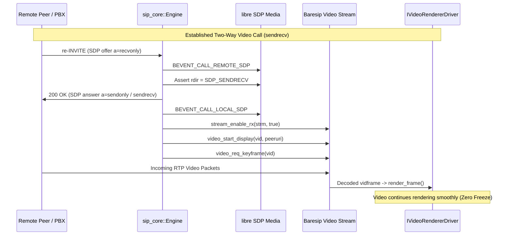
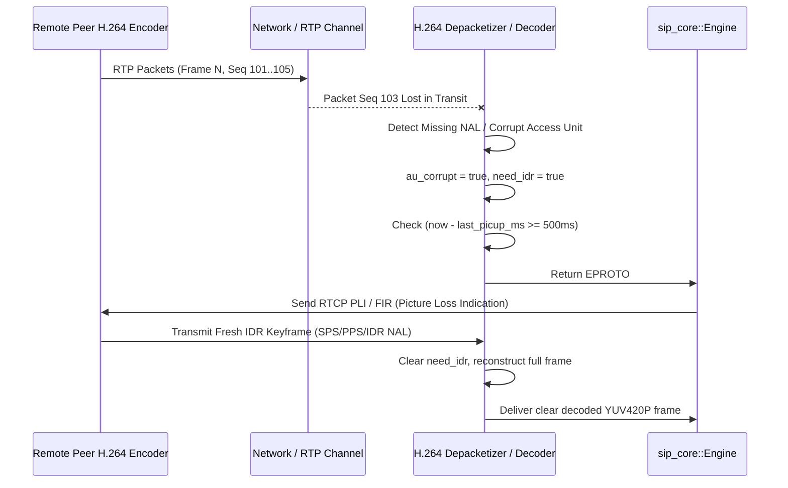

# Spec: Video Media Driver & Resilient Streaming (`video-streaming`)

## 1. Problem & Architecture Overview

### Problem
VoIP video stream management, hardware codec acceleration (`VideoToolbox` H.264), camera capture (`AVCaptureSession`), video display rendering (`SipVideoView`), and critical resilient streaming bug fixes (preserving the video RX pipeline on mid-call in-dialog re-INVITEs offering `recvonly`, and requesting RTCP PLI/FIR keyframes upon RTP packet loss) are currently tightly coupled to the Objective-C++ adapter (`Sources/SipSdk/SipClientBaresipV4.mm`).

Because these video drivers and recovery state machines are locked inside iOS-specific code, application developers cannot reuse the video pipeline across Android, macOS, Windows, and Linux. Furthermore, the existing Objective-C++ codebase duplicates low-level Baresip lifecycle and SIP session code that has already been extracted into the portable C++17 core (`sip_core`) and universal C ABI (`sip_abi`).

### Solution
1. **Pluggable Media Driver Architecture (`core/include/media_driver.h`, `core/include/sip_abi.h`)**:
   - Define clean, abstract C++ interfaces and pure C ABI driver structs for multimedia hardware components:
     - `IVideoCaptureDriver` (`sip_video_capture_driver_t`): Hardware camera capture, front/back switching, local preview, and raw YUV420P frame delivery to Baresip's `vidsrc`.
     - `IVideoRendererDriver` (`sip_video_renderer_driver_t`): Decoded remote video frame delivery to platform display surfaces (`SipVideoView` on Apple, `SipSurfaceView` on Android), aspect ratio resize events, and surface clearing.
     - `IVideoCodecDriver` (`sip_video_codec_driver_t`): Hardware codec registration bridge to Baresip's `vidcodecl`.
   - Provide built-in synthetic/mock drivers in `sip_core` for headless testing without physical cameras or displays.
2. **Resilient Video Streaming in C++ Core (`core/src/engine.cpp`, `core/src/call_session.cpp`)**:
   - **re-INVITE `recvonly` RX Stream Preservation**: When remote peers or PBX systems send mid-call in-dialog re-INVITEs offering `a=recvonly`, `sip_core::Engine` intercepts `BEVENT_CALL_REMOTE_SDP` and `BEVENT_CALL_LOCAL_SDP`, re-asserts `rdir = SDP_SENDRECV`, re-enables stream RX, reactivates `video_start_display`, and triggers `video_req_keyframe` so remote video display never freezes.
   - **RTCP PLI/FIR Packet Loss Recovery**: Detect packet loss or missing NALUs during RTP depacketization; return `EPROTO` to prompt Baresip to transmit an RTCP Picture Loss Indication (PLI) or Full Intra Request (FIR) to the remote encoder, rate-limited to at most one request per 500 ms (`last_picup_ms`). Export explicit C ABI function `sip_call_request_keyframe(call)`.
3. **Turnkey iOS Platform Binding & Parity Lock (`Sources/SipSdk/SipClientBaresipV4.mm`)**:
   - Implement the `media_driver` interfaces using Apple `VideoToolbox` H.264 hardware encoding/decoding, `AVCaptureSession` / simulator synthetic camera feed, and `SipVideoView` rendering.
   - Unify `SipClient` and `SipCall` over `sip_abi`, delegating account registration, lifecycle, calls, and telephony controls to `sip_core` while preserving 100% API compatibility with `Sources/SipSdk/include/SipClient.h`.
   - Verify zero regressions against `scripts/verify-ios-video-tests.sh`, `scripts/verify-sim-app-launch.sh`, `scripts/verify-spm-video-sdk.sh`, and `scripts/verify-xcode-app-build.sh`.

Glossary: [`../../CONTEXT.md`](../../CONTEXT.md). ADR: [`../../docs/adr/0001-cross-platform-cpp-core-c-abi.md`](../../docs/adr/0001-cross-platform-cpp-core-c-abi.md). Parent Epic: Issue #10. Issue: #14.

---

## 2. Public API & Driver Specification

### C ABI Extensions (`core/include/sip_abi.h`)

```c
typedef struct sip_video_frame_t {
    int width;
    int height;
    const uint8_t *y;
    const uint8_t *u;
    const uint8_t *v;
    int y_stride;
    int u_stride;
    int v_stride;
    uint64_t timestamp_ns;
} sip_video_frame_t;

typedef struct sip_video_capture_driver_t {
    void *user_data;
    int (*start)(void *user_data, int width, int height, int fps);
    void (*stop)(void *user_data);
    void (*set_frame_handler)(void *user_data, void (*handler)(const sip_video_frame_t *frame, void *arg), void *arg);
    void (*switch_camera)(void *user_data);
    void (*set_camera)(void *user_data, int position);
    void (*set_enabled)(void *user_data, bool enabled);
    bool (*is_enabled)(void *user_data);
} sip_video_capture_driver_t;

typedef struct sip_video_renderer_driver_t {
    void *user_data;
    void (*render_frame)(void *user_data, const sip_video_frame_t *frame);
    void (*on_stream_resized)(void *user_data, int width, int height);
    void (*clear)(void *user_data);
} sip_video_renderer_driver_t;

typedef struct sip_video_codec_driver_t {
    void *user_data;
    int (*register_codec)(void *user_data);
    void (*unregister_codec)(void *user_data);
} sip_video_codec_driver_t;

/**
 * Registers video capture driver for camera hardware integration.
 */
SIP_ABI_EXPORT int sip_client_set_video_capture_driver(sip_client_t *client, const sip_video_capture_driver_t *driver);

/**
 * Registers remote video renderer driver for decoded incoming video.
 */
SIP_ABI_EXPORT int sip_client_set_remote_renderer(sip_client_t *client, const sip_video_renderer_driver_t *renderer);

/**
 * Registers local video renderer driver for camera preview.
 */
SIP_ABI_EXPORT int sip_client_set_local_renderer(sip_client_t *client, const sip_video_renderer_driver_t *renderer);

/**
 * Registers hardware video codec driver (e.g. VideoToolbox H.264 or MediaCodec).
 */
SIP_ABI_EXPORT int sip_client_set_video_codec_driver(sip_client_t *client, const sip_video_codec_driver_t *driver);

/**
 * Requests an immediate RTCP PLI/FIR keyframe from the remote peer.
 */
SIP_ABI_EXPORT int sip_call_request_keyframe(sip_call_t *call);

/**
 * Camera and local preview controls.
 */
SIP_ABI_EXPORT int sip_client_switch_camera(sip_client_t *client);
SIP_ABI_EXPORT int sip_client_set_camera(sip_client_t *client, int position);
SIP_ABI_EXPORT int sip_client_set_local_video_enabled(sip_client_t *client, bool enabled);
SIP_ABI_EXPORT bool sip_client_is_local_video_enabled(const sip_client_t *client);
SIP_ABI_EXPORT int sip_client_start_local_preview(sip_client_t *client);
SIP_ABI_EXPORT int sip_client_stop_local_preview(sip_client_t *client);
SIP_ABI_EXPORT bool sip_client_is_local_preview_active(const sip_client_t *client);
```

### C++ Core Driver Interfaces (`core/include/media_driver.h`)

```cpp
namespace sip_core {

struct VideoFrame {
    int width{0};
    int height{0};
    const uint8_t *y{nullptr};
    const uint8_t *u{nullptr};
    const uint8_t *v{nullptr};
    int y_stride{0};
    int u_stride{0};
    int v_stride{0};
    uint64_t timestamp_ns{0};
};

using FrameHandler = std::function<void(const VideoFrame &frame)>;

class IVideoCaptureDriver {
public:
    virtual ~IVideoCaptureDriver() = default;
    virtual int start(int width, int height, int fps) = 0;
    virtual void stop() = 0;
    virtual void set_frame_handler(FrameHandler handler) = 0;
    virtual void switch_camera() = 0;
    virtual void set_camera(int position) = 0;
    virtual void set_enabled(bool enabled) = 0;
    virtual bool is_enabled() const = 0;
};

class IVideoRendererDriver {
public:
    virtual ~IVideoRendererDriver() = default;
    virtual void render_frame(const VideoFrame &frame) = 0;
    virtual void on_stream_resized(int width, int height) = 0;
    virtual void clear() = 0;
};

class IVideoCodecDriver {
public:
    virtual ~IVideoCodecDriver() = default;
    virtual int register_codec() = 0;
    virtual void unregister_codec() = 0;
};

} // namespace sip_core
```

---

## 3. Resilient Streaming State Machines

### 1. Mid-Call In-Dialog re-INVITE `recvonly` Recovery



### 2. Packet Loss RTCP PLI / FIR Recovery



---

## 4. User Stories

- **US11 (Outgoing Video Call)**: As a VoIP user, I want to initiate an outgoing video call with negotiated H.264 video and G.711 audio, so that I can see and hear the remote peer simultaneously.
- **US17 (Incoming Video Call)**: As a VoIP user, I want to answer an incoming video call with two-way video enabled, so that both parties share live camera feeds immediately.
- **US27 (Hardware Video Acceleration)**: As a mobile VoIP user, I want video encoding and decoding to use native hardware acceleration (`VideoToolbox` on Apple), so that video calls do not overheat my phone or drain the battery.
- **US28 (re-INVITE `recvonly` Stream Preservation)**: As a video caller, I want remote video to continue rendering smoothly even when the remote endpoint or PBX sends an in-dialog re-INVITE offering `recvonly`, so that the video stream does not freeze or black out mid-call.
- **US29 (RTP Packet Loss Keyframe Recovery)**: As a video caller, I want the SDK to automatically detect RTP packet loss and trigger RTCP PLI/FIR keyframe requests, so that visual corruption is quickly cleared by the remote encoder upon the next IDR frame.
- **US30 (Turnkey Platform Video Views)**: As an application developer, I want to drop a turnkey video widget (`SipVideoView` on Apple) into my UI layout, so that local camera preview and remote video render automatically with proper aspect ratios.
- **US31 (Camera Switching)**: As a mobile video caller, I want to toggle between the front and rear cameras during an active call, so that I can show my surroundings without dropping the video feed.
- **US32 (Dynamic Video Mute / Toggle)**: As a video caller, I want to turn my camera feed on or off dynamically during an ongoing call, so that I can temporarily disable my video without ending the call.
- **US37 (Main UI Thread Guarantee)**: As an SDK consumer, I want all event delegate callbacks to be dispatched directly on the platform's main UI thread, so that I never encounter multithreaded UI state corruption crashes.

---

## 5. Acceptance Criteria

1. **Pluggable Media Driver Abstraction**: C++ core exposes `IVideoCaptureDriver`, `IVideoRendererDriver`, and `IVideoCodecDriver` with corresponding C ABI bindings (`sip_video_capture_driver_t`, `sip_video_renderer_driver_t`, `sip_video_codec_driver_t`), allowing platforms to supply native hardware video pipelines.
2. **Turnkey iOS Binding**: `SipVideoView` renders remote and local video; `VideoToolbox` encodes and decodes H.264 video with RFC 6184 packetization; `AVCaptureSession` (and synthetic generator in Simulator) feeds live frames.
3. **Audio + Video Call Negotiation**: Outgoing and incoming video calls negotiate H.264 video streams alongside G.711 audio against Asterisk 22 PBX (echo `9001`) and loopback endpoints.
4. **Resilient re-INVITE `recvonly` Recovery**: When a peer sends an in-dialog re-INVITE offering `a=recvonly`, the SDK maintains video RX, re-asserts display, and requests a keyframe, ensuring remote video frames continue rendering without freeze.
5. **RTP Packet Loss Keyframe Recovery**: Packet loss in the H.264 stream drops corrupt frames, triggers an RTCP PLI keyframe request (rate-limited to 500 ms), and recovers clear decoding on the subsequent IDR frame.
6. **Zero Regression Test Verification**:
   - `scripts/verify-ios-video-tests.sh` passes 100% of test cases.
   - `scripts/verify-sim-app-launch.sh` passes 100% of simulator UI modes.
   - `scripts/verify-spm-video-sdk.sh` passes SwiftPM build and link across all slices.
   - `scripts/verify-xcode-app-build.sh` builds `SipSdk.xcodeproj` for Simulator and Device.
